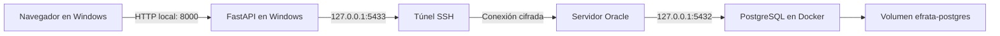

# Gestión de iglesia — TCU

Resumen técnico y bitácora del avance del **10 de octubre de 2026**. Documento elaborado el **11 de octubre de 2026**, como continuación de `8_de_Octubre.md`.

Se preparó un servidor en Oracle Cloud, se instaló Docker y se trasladó la base de datos local a PostgreSQL en ese servidor. Se conectó la aplicación de Windows a la base remota mediante un túnel SSH y se comprobó la carga de los registros de prueba desde el navegador. La aplicación todavía se ejecuta localmente; su despliegue y la automatización con GitHub quedaron como siguientes etapas.

## 1. Preparación del servidor en Oracle Cloud

Se creó una instancia dentro de la cuenta Free Tier, en la región **Mexico Central (Queretaro)**. Se mantuvo la decisión de trabajar dentro de los recursos gratuitos y no actualizar la cuenta a un plan de pago.

| Elemento | Configuración seleccionada |
| --- | --- |
| Instancia | `efrata-servidor` |
| Región | `mx-queretaro-1` |
| Dominio de disponibilidad | AD-1 |
| Sistema operativo | Ubuntu 24.04 Minimal aarch64 |
| Forma de cómputo | `VM.Standard.A1.Flex` |
| Procesador y memoria | 1 OCPU y 6 GB de RAM |
| Disco de arranque | Tamaño predeterminado mostrado de aproximadamente 46.6 GB |
| Discos adicionales | Ninguno |

Se eligió una imagen ARM compatible con Ampere. La consola completó la creación de la instancia con el estado **Succeeded** y un progreso del **100 %**.

Se revisaron los complementos del agente y se indicó desactivar Cloud Guard Workload Protection antes de crear la instancia. No se obtuvo una comprobación posterior de su estado. La selección de recursos elegibles no constituye una garantía permanente sobre cuotas, disponibilidad o condiciones del proveedor.

## 2. Configuración de la red

Se crearon por separado la red virtual, la subred pública y la salida a Internet. Después se seleccionaron esos recursos existentes en el formulario de creación de la instancia.

| Recurso | Nombre y configuración |
| --- | --- |
| Red virtual, VCN | `efrata-red`, rango `10.0.0.0/16` |
| Subred regional pública | `efrata-subred`, rango `10.0.0.0/24` |
| Internet Gateway | `efrata-internet` |
| Tabla de rutas | `Default Route Table for efrata-red` |
| Ruta de salida | Destino `0.0.0.0/0` hacia el Internet Gateway |
| Lista de seguridad | `Default Security List for efrata-red` |
| DNS interno de la VCN | `efrata.oraclevcn.com` |
| IPv6 | No configurado |

Se activó la asignación de IPv4 pública para poder acceder por SSH. El nombre DNS de la VCN corresponde a la red interna de Oracle; no equivale a registrar un dominio público para la página web.

La conexión SSH posterior comprobó que existía conectividad con la instancia. No se publicó PostgreSQL directamente en Internet.

## 3. Acceso SSH y actualización de Ubuntu

Se descargó el par de claves SSH y se utilizó la clave privada desde PowerShell para iniciar sesión como `ubuntu`. Se ajustaron los permisos del archivo privado en Windows porque OpenSSH rechazaba el acceso de un grupo adicional al archivo.

Se distinguieron las dos terminales utilizadas durante la preparación:

| Indicador de la terminal | Entorno donde se ejecutan los comandos |
| --- | --- |
| `PS C:\Users\PC>` | Windows local: SSH, transferencia de archivos y ejecución de la app |
| `ubuntu@efrata-red:~$` | Servidor Ubuntu: Docker, PostgreSQL y restauración |

Se actualizaron los paquetes de Ubuntu mediante `apt update` y `apt upgrade`. Después se reinició el servidor y se volvió a conectar por SSH. El comando `uname -r` confirmó el kernel **7.0.0-1013-oracle**.

Se conservó Ubuntu 24.04; no se ejecutó la actualización de distribución sugerida en el mensaje de bienvenida.

## 4. Instalación de Docker en el servidor

Se agregó la clave de firma y el repositorio oficial de Docker para Ubuntu Noble, arquitectura `arm64`. Se instalaron Docker Engine, su cliente, containerd y los complementos Buildx y Compose.

Se ejecutó la comprobación:

```bash
sudo docker run --rm hello-world
```

La salida **Hello from Docker!** confirmó que el cliente se comunicaba con el servicio, podía descargar una imagen ARM y ejecutar un contenedor.

Los comandos del servidor se ejecutaron con `sudo`. No se configuró una cuenta de Docker Hub ni se necesitó Docker Desktop dentro de Ubuntu.

## 5. Respaldo y transferencia de la base local

Se identificó el contenedor local `iglesia-db`, con la imagen `postgres:17-bookworm`, y la base `gestion_iglesia`. Se generó un respaldo con `pg_dump` en formato personalizado y se comprobó su índice mediante `pg_restore --list`.

El respaldo se guardó fuera del repositorio en:

```text
C:\Users\PC\Desktop\TCU Jeff\respaldos\gestion_iglesia-20261010-180725.dump
```

Esta carpeta se utilizó como ubicación del respaldo; el proyecto de trabajo siguió siendo `TCU_Inglesia/tcu-app`.

El archivo de 9240 bytes incluía:

- Las tablas `public.prueba` y `public.usuarios`, con sus datos.
- Sus secuencias y valores correspondientes.
- Las restricciones y el índice único de correo.
- Los procedimientos `crear_usuario` y `obtener_usuario_login`.

La presencia de `obtener_usuario_login` en el respaldo confirmó que ya existía en la base local, resolviendo la duda documentada en la bitácora anterior. Esto no significa que el inicio de sesión de la aplicación estuviera implementado.

Se transfirió el archivo al directorio personal de `ubuntu` mediante `scp` desde Windows. La transferencia terminó al **100 %**. La base local no se eliminó ni se modificó para realizar la copia.

## 6. PostgreSQL persistente en Oracle

Se preparó `~/efrata/postgres.env` con la contraseña del administrador, introducida de forma oculta en la terminal. Se restringieron los permisos de la carpeta y del archivo de configuración.

Se creó el contenedor remoto con esta configuración:

| Elemento | Configuración |
| --- | --- |
| Contenedor | `iglesia-db` |
| Imagen | `postgres:17-bookworm` |
| Volumen | `efrata-postgres` |
| Montaje de datos | `/var/lib/postgresql/data` |
| Puerto publicado en Ubuntu | `127.0.0.1:5432` |
| Política de reinicio | `unless-stopped` |
| Administrador inicial | `postgres` |

El contenedor local y el remoto tienen el mismo nombre, pero pertenecen a máquinas y motores de Docker distintos. Sus volúmenes también son independientes.

Se comprobó el servicio mediante:

```bash
sudo docker exec iglesia-db pg_isready -U postgres
```

La respuesta **accepting connections** confirmó que PostgreSQL estaba aceptando conexiones. La publicación en `127.0.0.1` mantiene el puerto accesible desde el propio servidor; para acceder desde Windows se utilizó SSH.

## 7. Restauración y usuario de la aplicación

Se creó el rol `iglesia_app` con permiso de inicio de sesión, sin privilegios de superusuario ni permisos para crear bases o roles. Se creó `gestion_iglesia` con ese rol como propietario.

Se restauró el respaldo en la base nueva mediante:

```bash
sudo docker exec -i iglesia-db pg_restore -U postgres -d gestion_iglesia --role=iglesia_app --no-owner --single-transaction < ~/gestion_iglesia-20261010-180725.dump
```

Se utilizó `--role` para restaurar como el propietario de la aplicación, `--no-owner` para omitir las instrucciones de propiedad del respaldo y `--single-transaction` para agrupar la restauración en una transacción.

La operación terminó sin errores visibles. La consulta `\dt` mostró las tablas `prueba` y `usuarios`, ambas con propietario `iglesia_app`.

Finalmente se asignó la contraseña del rol mediante `\password iglesia_app`, con entrada oculta y confirmación. Las credenciales del administrador y del usuario de la aplicación tienen funciones separadas. Sus valores no se incluyen en esta documentación.

Estos pasos describen una restauración ya realizada; no deben repetirse sobre la base existente como si estuviera vacía.

## 8. Conexión local mediante túnel SSH

Se abrió un túnel desde PowerShell para reenviar el puerto local **5433** al puerto **5432** de la interfaz local del servidor. Se eligió 5433 para conservar la posibilidad de ejecutar la base local en 5432.



Se configuró el `.env` local con la siguiente estructura, completando la contraseña únicamente en el archivo privado:

```dotenv
POSTGRES_DB=gestion_iglesia
POSTGRES_USER=iglesia_app
POSTGRES_PASSWORD=
PGHOST=127.0.0.1
PGPORT=5433
```

Se aclaró que `ORACLE_PASSWORD` no es utilizada por la conexión actual de la aplicación. El acceso al servidor utiliza la clave SSH; el acceso a PostgreSQL utiliza el usuario y la contraseña de la base.

La opción `-N` de SSH mantiene el túnel sin abrir una consola remota. Por eso la ventana permanece sin mensajes mientras la conexión está activa. Cerrar esa ventana o apagar Windows interrumpe el túnel, pero no elimina los datos ni detiene por sí mismo PostgreSQL en Oracle.

## 9. Verificación de la aplicación

Se indicó reiniciar Uvicorn para cargar el cambio de puerto del `.env`. Se comprobó desde el navegador la carga de la tabla de prueba: aparecieron **Luis** y **Ana**, con sus mensajes correspondientes.

Esta comprobación se realizó con la configuración del túnel y de la base remota. No se documentó una prueba adicional de escritura desde la aplicación contra Oracle ni una comparación completa de cantidades de filas entre ambas bases.

Las tarjetas superiores del home siguen mostrando valores de ejemplo. La carga de los dos registros verifica la consulta de la tabla, no esas métricas ni todas las funciones de la interfaz.

| Componente | Estado al finalizar |
| --- | --- |
| Servidor Oracle y acceso SSH | Operativos |
| Docker en Ubuntu | Instalado y comprobado |
| PostgreSQL remoto | Operativo, con respaldo restaurado |
| Lectura desde la app local | Comprobada en la tabla del navegador |
| Aplicación FastAPI | Sigue ejecutándose en Windows |
| Sitio público y HTTPS | Pendientes |
| Actualización automática desde GitHub | Pendiente |

## 10. Siguiente etapa y aspectos pendientes

Se acordó preparar primero un despliegue controlado de la aplicación y automatizarlo después. El orden previsto es:

1. Revisar las dependencias, el arranque y la exclusión de archivos privados de Git.
2. Crear el `Dockerfile` de la aplicación y la configuración de Docker Compose.
3. Conectar la app y PostgreSQL por una red interna de Docker, conservando el volumen remoto existente.
4. Desplegar y comprobar lectura, escritura y reinicio de los servicios.
5. Configurar una dirección web y HTTPS, revisando una opción compatible con el presupuesto gratuito.
6. Completar el login, las sesiones y los permisos antes de exponer funciones administrativas.
7. Preparar GitHub Actions para actualizar la aplicación, comprobando las cuotas del repositorio.
8. Documentar respaldos periódicos fuera del servidor, restauración y vuelta a una versión anterior de la app.

Se explicó que actualizar el contenedor de la aplicación no debe reemplazar los datos de PostgreSQL. Los cambios de estructura de tablas necesitarán un proceso de migraciones independiente del despliegue del código.

La restauración realizada comprobó el uso del respaldo inicial, pero todavía no existe una programación de copias de los nuevos datos que se generen en Oracle. El volumen persistente no sustituye esos respaldos.

Al cerrar esta etapa no se habían creado los archivos de despliegue de la aplicación ni el flujo de GitHub Actions. Tampoco se había publicado la web. Se mantuvo por decisión del responsable la configuración de credenciales existente; los valores privados se omiten de la bitácora y deberán mantenerse fuera del código versionado.
