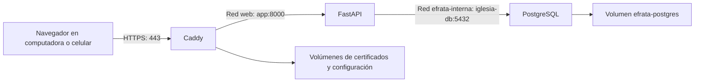
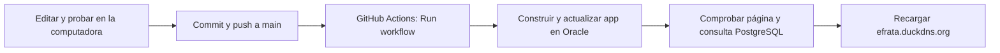

# Gestión de iglesia — TCU

Resumen técnico y bitácora del avance del **15 de octubre de 2026**, como continuación de `10_de_Octubre.md`.

Se preparó la imagen Docker de la aplicación, se desplegó FastAPI en Oracle junto a la base de datos existente y se publicó el sitio con HTTPS en **https://efrata.duckdns.org**. Se configuró y probó un flujo de GitHub Actions que permite actualizar el código de la aplicación mediante un botón manual. Se comprobó la consulta a PostgreSQL después del despliegue.

## 1. Organización de los archivos de despliegue

Se agregaron archivos para construir, ejecutar y documentar la aplicación. Se conservó la separación entre la raíz del repositorio y la carpeta `tcu-app`:

```text
TCU_Inglesia/
├── .github/
│   └── workflows/
│       └── deploy-oracle.yml  # Despliegue manual desde GitHub Actions
└── tcu-app/
    ├── Dockerfile            # Construcción de la imagen de la app
    ├── .dockerignore         # Exclusiones del contexto de construcción
    ├── .gitignore            # Exclusiones del repositorio
    ├── compose.yaml          # Aplicación, Caddy, redes y volúmenes de Caddy
    ├── Caddyfile             # Dominio público y proxy hacia FastAPI
    ├── Makefile              # Comando de desarrollo local existente
    └── docs/
        └── docker.md         # Guía de construcción y despliegue
```

El flujo se colocó en `.github/workflows` de la raíz, no dentro de `tcu-app`, para que GitHub lo reconozca. Los archivos privados `.env` y `.env.server` no forman parte de esta estructura versionada.

## 2. Construcción de la imagen Docker

Se utilizó `python:3.11-slim-bookworm` como base y se copió uv desde su imagen oficial, fijando la versión `0.13.1`. Se instalaron las dependencias mediante:

```bash
uv sync --locked --no-dev --no-cache
```

Se reutilizaron `pyproject.toml` y `uv.lock`, sin preparar una segunda lista de dependencias. Se creó un entorno virtual Linux dentro de `/app`; el entorno `.venv` de Windows no se copia a la imagen.

Se copiaron `main.py`, `backend` y `frontend`. La aplicación se ejecuta con el usuario `app`, UID y GID 10001, sin privilegios de administrador. El comando base de arranque utiliza Uvicorn en `0.0.0.0:8000`, sin `--reload`.

Se construyó la imagen local con:

```powershell
docker build -t efrata-app:local .
```

Se ejecutó un contenedor temporal publicando `127.0.0.1:8001` de Windows hacia el puerto 8000 del contenedor. Se comprobó la carga de páginas y estilos. Esa prueba inicial no incluyó variables de conexión a PostgreSQL.

Se aclaró que `0.0.0.0:8000` describe dónde escucha Uvicorn dentro del contenedor; para abrir la prueba desde el navegador se utilizó `http://127.0.0.1:8001`.

## 3. Archivos privados y permisos

Se configuró `.dockerignore` con una lista de archivos y carpetas permitidos. Se excluyeron el entorno virtual local, los archivos de Git, cachés de Python, archivos de entorno, claves y respaldos del contexto de construcción.

Se ampliaron las exclusiones de `.gitignore` para claves privadas. Se comprobó que `.env` estaba ignorado y que la búsqueda de archivos sensibles ya registrados devolvía únicamente `.env.example`.

En Oracle se creó `~/efrata/app/.env.server` con la contraseña del rol `iglesia_app`, introducida de forma oculta. Se aplicaron permisos `600`. El archivo contiene la contraseña en texto y no está cifrado por llevar un nombre distinto; su acceso depende de los permisos del servidor.

Se corrigieron los permisos de las carpetas de código para que el usuario del contenedor pudiera leerlas. Las carpetas transferidas tenían inicialmente permisos `700`, que impedían importar el módulo de la app. Se aplicó lectura y recorrido sobre `backend` y `frontend`, conservando los permisos privados del archivo de entorno.

La transferencia del flujo de GitHub utiliza `--chmod=D755,F644` para mantener permisos adecuados en el código que envía.

## 4. Aplicación y PostgreSQL dentro de Oracle

Se comprobó que PostgreSQL seguía utilizando el contenedor `iglesia-db` y el volumen `efrata-postgres`, montado en `/var/lib/postgresql/data`.

Se creó la red `efrata-interna` y se conectó el contenedor de PostgreSQL existente. Compose utiliza esa red como `external`, por lo que debe existir antes de iniciar la aplicación. Ese atributo indica que Compose no administra su creación; no significa que la base se publique en Internet.

| Elemento | Configuración |
| --- | --- |
| Carpeta remota de la aplicación | `/home/ubuntu/efrata/app` |
| Proyecto de Compose | `efrata` |
| Servicio y contenedor de la app | `app`, `efrata-app-1` |
| Imagen remota de la app | `efrata-app:servidor` |
| Host y puerto usados por la app | `iglesia-db:5432` |
| Base y rol de aplicación | `gestion_iglesia`, `iglesia_app` |
| Acceso directo desde Ubuntu | `127.0.0.1:8000` |
| Red de datos existente | `efrata-interna` |

PostgreSQL permaneció fuera de los servicios administrados por este Compose. Se conservaron su contenedor, su configuración y sus datos.

Se transfirió el código desde Windows y se construyó la imagen en Oracle para ejecutar la versión ARM64. Se comprobó el estado `Up` y se consultó `/api/prueba` desde Ubuntu. La respuesta JSON devolvió los registros de Luis y Ana.

## 5. Dominio público y reglas de acceso

Se registró el subdominio gratuito `efrata.duckdns.org` en Duck DNS y se configuró su IPv4 para apuntar a la dirección pública del servidor. Se comprobó la resolución desde Ubuntu con `getent ahostsv4`.

Se conservaron las reglas existentes de la lista de seguridad de `efrata-red` y se agregaron dos reglas de entrada:

| Protocolo | Origen | Puerto de destino | Uso |
| --- | --- | --- | --- |
| TCP | `0.0.0.0/0` | 80 | HTTP y validación del dominio |
| TCP | `0.0.0.0/0` | 443 | HTTPS |

Se dejaron sin restricción los puertos de origen y se mantuvo desactivada la opción Stateless. Se comprobó que los puertos web del servidor estaban libres antes de iniciar Caddy. No se abrió PostgreSQL al público.

El DNS se configuró manualmente. No se instaló un actualizador automático de Duck DNS; si cambia la IP pública de Oracle, será necesario actualizar el registro.

## 6. Caddy y HTTPS

Se agregó el servicio `caddy` con la imagen `caddy:2-alpine`. Comparte la red `web` con la aplicación y publica los puertos TCP 80 y 443. El servicio no pertenece a la red de PostgreSQL.

Se preparó el siguiente `Caddyfile`:

```caddyfile
efrata.duckdns.org {
    encode gzip
    reverse_proxy app:8000
}
```

Se validó la configuración antes de iniciar el servicio. Caddy obtuvo correctamente un certificado de Let's Encrypt y habilitó la redirección de HTTP a HTTPS. Sus volúmenes `caddy_data` y `caddy_config` conservan los certificados y el estado necesario para su gestión.

Se ajustó el comando de Uvicorn en Compose con `--proxy-headers --forwarded-allow-ips '*'` para reconocer el HTTPS que comunica Caddy. Esto corrigió la generación de enlaces HTTP de estilos y scripts dentro de la página HTTPS. El puerto de la app sigue publicado únicamente en la interfaz local del servidor; el acceso público pasa por Caddy.



Se comprobó en el enlace público la presentación con estilos y la carga de los dos registros. Los túneles SSH quedaron como herramientas de administración y pruebas, no como requisito para visitar el sitio. La aplicación se ejecuta en Oracle y no depende de mantener encendida la computadora de desarrollo.

## 7. Preparación del repositorio y acceso desde GitHub

Se confirmó el repositorio público `SebesHJDEV/TCU_Inglesia`, la rama `main` y el remoto `origin`. Se subieron los archivos del despliegue y la documentación mediante commit y push.

Se creó un par de claves Ed25519 exclusivo para GitHub Actions. Se agregó la clave pública a `~/.ssh/authorized_keys` de `ubuntu`, conservando el acceso SSH existente, y se comprobó una conexión con esa nueva clave.

Se guardaron cuatro secretos del repositorio:

| Nombre | Propósito |
| --- | --- |
| `ORACLE_SSH_KEY` | Clave privada usada por el flujo para conectarse |
| `ORACLE_HOST` | Dirección del servidor |
| `ORACLE_USER` | Usuario remoto `ubuntu` |
| `ORACLE_KNOWN_HOSTS` | Identidad pública verificada del servidor SSH |

No se incluyeron sus valores privados en el código ni en esta bitácora. La verificación de identidad SSH se mantiene activada mediante `StrictHostKeyChecking=yes`.

Se eligió un ejecutor estándar `ubuntu-24.04` para el repositorio público y no se agregaron pasos de almacenamiento de artefactos ni cachés de Actions. Se instaló `rsync` en Oracle y se comprobó que Docker Compose puede ejecutarse con `sudo -n`, sin una pregunta interactiva de contraseña.

## 8. Funcionamiento del despliegue manual

Se creó el flujo **Desplegar app en Oracle** con `workflow_dispatch`. Solo despliega la rama `main`; no se activa automáticamente con cada push. Se limitaron los permisos de GitHub a lectura del contenido y se configuró una única ejecución de despliegue a la vez.

El flujo realiza estas operaciones:

1. Descarga el código del repositorio y prepara la clave SSH y la identidad del servidor en el ejecutor temporal.
2. Comprueba las herramientas y los archivos privados que deben existir en Oracle.
3. Transfiere con `rsync` el código de ejecución y sus archivos de dependencias. Sincroniza `backend` y `frontend`, retirando de esas carpetas los archivos que ya no existen en el código enviado, con exclusiones para archivos privados y cachés.
4. Conserva la imagen anterior mediante la etiqueta `efrata-app:anterior`.
5. Construye la nueva imagen en Oracle y comprueba que puede importar `main:app` en un contenedor temporal.
6. Actualiza únicamente el servicio `app`, sin reiniciar sus dependencias.
7. Comprueba mediante HTTP local tanto `/` como `/api/prueba`, con reintentos durante el arranque.

Se preparó una recuperación de la imagen anterior si falla el arranque o la comprobación posterior. La ruta de recuperación quedó implementada, pero no se provocó un fallo de despliegue para comprobarla en Oracle. No revierte datos, migraciones SQL ni los archivos fuente transferidos al servidor.

Se corrigió la entrada estándar del contenedor temporal con `--interactive=false`, `-T` y una redirección desde `/dev/null`. El primer intento consumía el resto del script enviado por SSH y terminaba en verde antes de actualizar la aplicación. Después del ajuste se comprobó la continuación del script y se repitió el despliegue completo.

## 9. Resultado comprobado y uso habitual

El registro de la ejecución corregida mostró la recreación y el arranque de `efrata-app-1`, seguidos del mensaje:

```text
Aplicacion y consulta de PostgreSQL verificadas.
```

Una consulta inicial coincidió con el arranque y no obtuvo respuesta; el siguiente intento terminó correctamente. Después se comprobó de nuevo la página pública, con su diseño y los dos registros de prueba.

El procedimiento habitual de actualización quedó así:



Se debe ejecutar **Run workflow** sobre `main` para publicar la versión subida. Guardar un archivo local no lo publica. Repetir una ejecución anterior mediante Re-run utiliza el commit asociado a esa ejecución, por lo que no es equivalente a desplegar los cambios más recientes.

Se comprobaron la lectura de la tabla y el arranque de la aplicación. No se documentó una prueba de escritura desde el formulario público, una prueba completa del registro de cuentas, una comparación de todos los datos ni un reinicio completo del servidor después de incorporar estos nuevos servicios.

## 10. Estado actual y siguientes etapas

Se dejó operativa la infraestructura necesaria para continuar desarrollando las funciones del sistema:

| Componente | Estado |
| --- | --- |
| Aplicación en Docker sobre Oracle | Operativa |
| Conexión de la app a PostgreSQL | Comprobada por consulta |
| Dominio y HTTPS | Operativos |
| Estilos y JavaScript en el sitio público | Carga y consulta comprobadas |
| Despliegue desde GitHub Actions | Manual, probado hasta la consulta final |
| Despliegue automático al hacer push | No configurado |
| Login, sesiones y permisos | Pendientes |
| Métricas superiores del home | Continúan como datos de ejemplo |
| Respaldos periódicos de Oracle | Pendientes |

El flujo actual actualiza `Dockerfile`, `.dockerignore`, las dependencias, `main.py`, `backend` y `frontend`. No transfiere `compose.yaml`, `Caddyfile` ni `.env.server`, y no ejecuta migraciones SQL. Los cambios de infraestructura y de estructura de datos requieren sus propios pasos.

Quedan por completar el modelo de datos real, los formularios y sus validaciones, el inicio y cierre de sesión y la protección de funciones administrativas. El sitio publicado mantiene las rutas actuales sin haber incorporado todavía esos controles.

También quedan pendientes los respaldos periódicos fuera del servidor, su procedimiento de recuperación y el mantenimiento del espacio ocupado por imágenes y cachés de construcción. La última ejecución incluyó un aviso de obsolescencia de Node.js 20 en `actions/checkout@v4`; no impidió el despliegue, pero queda por actualizar esa acción.

Referencias técnicas utilizadas: [uv en Docker](https://docs.astral.sh/uv/guides/integration/docker/), [redes de Docker Compose](https://docs.docker.com/compose/how-tos/networking/), [HTTPS automático de Caddy](https://caddyserver.com/docs/automatic-https), [FastAPI detrás de un proxy](https://fastapi.tiangolo.com/advanced/behind-a-proxy/) y [facturación de GitHub Actions](https://docs.github.com/en/billing/concepts/product-billing/github-actions).
