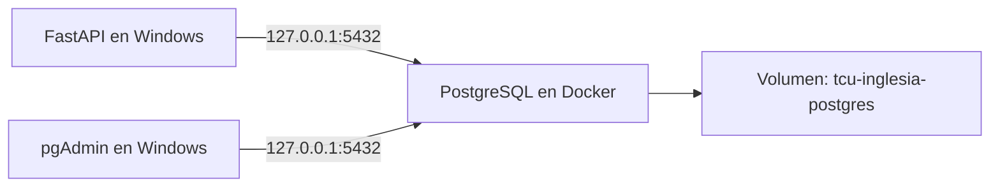
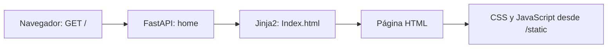
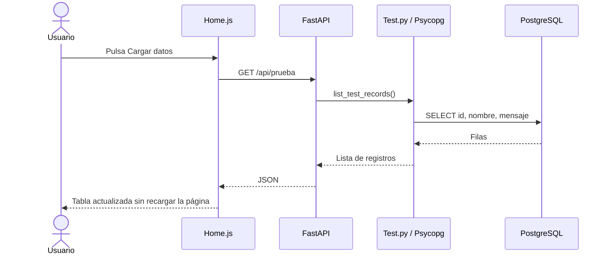

# Gestión de iglesia — TCU

Resumen técnico y bitácora del entorno de desarrollo. Actualizado al **7 de octubre de 2026**.

Se preparó una aplicación web que consulta PostgreSQL y muestra sus registros mediante un botón, sin recargar la página. Esta primera prueba permite comprobar la comunicación entre la interfaz, el backend y la base de datos antes de desarrollar las funciones del sistema.

## 1. Revisión y organización del proyecto

Se revisaron dos carpetas independientes:

- **TCU Jeff:** estructura de referencia proporcionada por el hermano. Los archivos principales revisados eran plantillas vacías.
- **TCU_Inglesia/tcu-app:** proyecto de trabajo. Ya contenía una página HTML, estilos y una base de FastAPI.

Se conservó la separación entre backend y frontend. Se simplificó el entorno para ejecutar Python directamente en Windows y mantener únicamente PostgreSQL en Docker. La configuración inicial de Compose y del contenedor de la aplicación se retiró para concentrarse en el desarrollo local. También se retiró MkDocs; la documentación se mantiene en este README.

```text
tcu-app/
├── main.py                    # Entrada para iniciar la aplicación
├── pyproject.toml             # Dependencias declaradas
├── uv.lock                    # Versiones de dependencias
├── .env.example               # Plantilla de configuración sin contraseña
├── .env                       # Configuración privada, excluida de Git
├── backend/
│   ├── schema.sql             # SQL de referencia para la tabla de prueba
│   └── app/
│       ├── app.py             # FastAPI, rutas y configuración web
│       ├── database.py        # Conexión a PostgreSQL
│       └── Test.py            # Consulta utilizada por la ruta JSON
└── frontend/
    ├── templates/
    │   └── Index.html         # Home y tabla de prueba
    └── static/
        ├── css/styles.css     # Estilos de la página
        └── js/Home.js         # Botón, petición y construcción de filas
```

## 2. Tecnologías utilizadas

| Tecnología | Uso en el proyecto |
| --- | --- |
| Python 3.11.9 | Entorno local utilizado; el proyecto admite Python 3.11 y 3.12 |
| FastAPI 0.116.1 | Rutas que entregan HTML y datos JSON |
| Jinja2 3.1.6 | Carga y generación de plantillas HTML |
| Uvicorn 0.35.0 | Servidor que ejecuta FastAPI |
| Psycopg 3.2.9 | Conexión y consultas a PostgreSQL |
| PostgreSQL 17 | Almacenamiento de datos en un contenedor |
| Docker Desktop | Ejecución del contenedor y administración del volumen |
| pgAdmin 4 | Administración visual de la base y ejecución de SQL |
| JavaScript con fetch | Consulta de datos sin recargar la página |

Se aprovechó el entorno `.venv` existente y se comprobó su Python. `pyproject.toml` y `uv.lock` describen las dependencias; no son instaladores ni sustituyen al ejecutable Python. La aplicación se inició directamente con el Python de `.venv`.

## 3. Preparación de PostgreSQL

Se inició Docker Desktop, se creó un volumen y se ejecutó la imagen oficial `postgres:17-bookworm`. PostgreSQL se instaló dentro del contenedor, sin necesitar otro servidor PostgreSQL en Windows.

| Elemento | Nombre o dirección |
| --- | --- |
| Contenedor | `iglesia-db` |
| Volumen persistente | `tcu-inglesia-postgres` |
| Base de datos | `gestion_iglesia` |
| Usuario configurado | `iglesia_app` |
| Acceso desde Windows | `127.0.0.1:5432` |



El contenedor ejecuta PostgreSQL; el volumen conserva sus archivos y datos al reemplazar el contenedor. El código de la aplicación permanece en la carpeta del proyecto. El puerto se publicó solo en la interfaz local de Windows.

Se preparó `.env` para compartir los datos de conexión entre Docker y Python:

```dotenv
POSTGRES_DB=gestion_iglesia
POSTGRES_USER=iglesia_app
POSTGRES_PASSWORD=
PGHOST=127.0.0.1
PGPORT=5432
```

La contraseña debe completarse únicamente en la copia privada, sin espacios alrededor del valor. `.env` está excluido mediante `.gitignore`. La plantilla `.env.example` aún utiliza `tcu` como nombre y usuario de ejemplo: al preparar otro entorno deben ajustarse a los valores elegidos.

La imagen inicializa la base y el usuario cuando el volumen está vacío. Cambiar después `.env` no modifica la contraseña almacenada en PostgreSQL. Se configuró el acceso desde pgAdmin y se verificó la conexión; para el cliente utilizado se añadió `GSS encmode = disable` en sus parámetros.

## 4. Creación de la tabla de prueba

Se utilizó Query Tool de pgAdmin sobre `gestion_iglesia` para crear la tabla:

```sql
CREATE TABLE prueba (
    id bigint GENERATED ALWAYS AS IDENTITY PRIMARY KEY,
    nombre varchar(100) NOT NULL,
    mensaje varchar(300) NOT NULL
);
```

Se insertaron dos registros de ejemplo:

```sql
INSERT INTO prueba (nombre, mensaje)
VALUES
    ('Ana', 'Primer registro de prueba'),
    ('Luis', 'La conexión funciona');
```

Se comprobaron mediante `SELECT` y desde el explorador de pgAdmin:

```text
Databases → gestion_iglesia → Schemas → public → Tables → prueba
```

Estos comandos documentan lo realizado; no es necesario repetirlos en la base existente. Repetir el INSERT agrega nuevas filas. `backend/schema.sql` conserva una variante con comprobaciones adicionales para impedir textos en blanco; no hay un sistema de migraciones y ese archivo no se ejecuta al iniciar FastAPI.

## 5. Configuración del home

Se configuró FastAPI en `backend/app/app.py`. `main.py` importa y expone esa misma aplicación como punto de entrada.

Se calculó la ubicación de `frontend` a partir de `__file__`, evitando escribir una ruta fija de Windows. Se configuraron:

- **StaticFiles:** publica CSS y JavaScript bajo `/static`.
- **Jinja2Templates:** localiza los HTML en `frontend/templates`.
- **GET `/`:** devuelve `Index.html` mediante `TemplateResponse`.



El home utiliza `context={}` porque los registros se solicitan después mediante JavaScript. La configuración actual del home no consulta la base al abrir la página.

## 6. Separación de conexión, consulta y ruta

Se reutilizó `get_connection()` desde `database.py`. La función obtiene host, puerto, base, usuario y contraseña del entorno y abre una conexión mediante Psycopg.

Se creó `list_test_records()` en `Test.py`, que importa la función de conexión y ejecuta:

```sql
SELECT id, nombre, mensaje FROM prueba ORDER BY id DESC;
```

Se utilizaron dos bloques `with`: uno administra la conexión y otro el cursor que ejecuta el SQL. Los recursos se cierran al terminar. `dict_row` devuelve filas con nombres de campos; `fetchall()` recoge los resultados.

Se agregó **GET `/api/prueba`** en `app.py`. Esta ruta llama a la consulta y FastAPI convierte el resultado en JSON. Para futuras consultas con entradas del usuario, se utilizarán parámetros de Psycopg en lugar de concatenar texto en SQL.

## 7. Carga de datos desde JavaScript

Se sustituyeron las filas de ejemplo del directorio por una tabla con las columnas ID, nombre y mensaje. Se agregó el botón **Cargar datos** y se enlazó `Home.js` desde el HTML.

El JavaScript escucha el clic, solicita `/api/prueba` con `fetch`, interpreta el JSON y construye las filas usando `textContent`. Antes de mostrarlas limpia las filas anteriores para evitar duplicarlas. También muestra el estado de carga, comprueba la respuesta y vuelve a habilitar el botón al finalizar.



## 8. Ejecución del entorno actual

Con Docker Desktop encendido, iniciar el contenedor existente:

```powershell
docker start iglesia-db
```

Desde `tcu-app`, iniciar la aplicación:

```powershell
.\.venv\Scripts\python.exe -m uvicorn main:app --reload --env-file .env
```

`main:app` selecciona la aplicación; `--reload` aplica cambios de Python al guardar y `--env-file` carga la configuración privada. Para ver cambios de HTML o JavaScript también se recarga el navegador.

- Página: http://127.0.0.1:8000/
- Datos JSON: http://127.0.0.1:8000/api/prueba

Para revisar y detener:

```powershell
docker logs --tail 30 iglesia-db
docker stop iglesia-db
```

Uvicorn se detiene con **Ctrl+C** en su terminal.

### Preparación de otro entorno vacío

Con `.env` preparado, estos comandos crean el almacenamiento y el contenedor. No se repiten si ya existe `iglesia-db`:

```powershell
docker volume create tcu-inglesia-postgres
docker run -d --name iglesia-db --restart unless-stopped --env-file .env -p 127.0.0.1:5432:5432 -v tcu-inglesia-postgres:/var/lib/postgresql/data postgres:17-bookworm
```

En otra PC también será necesario preparar Python y sus dependencias; con uv instalado se puede utilizar `uv sync`. El entorno `.venv` no se copia entre computadoras. Se debe crear la tabla de prueba o restaurar un respaldo antes de consultar la API.

## 9. Persistencia y respaldos

Se documentó el procedimiento de respaldo. No se ha realizado todavía una prueba de restauración. Los comandos crean un archivo de respaldo sin redirigir datos binarios a través de PowerShell; debe utilizarse un nombre distinto por fecha para conservar versiones.

```powershell
New-Item -ItemType Directory -Force backups
docker exec iglesia-db sh -c 'pg_dump -U "$POSTGRES_USER" -d "$POSTGRES_DB" -Fc -f /tmp/iglesia.dump'
docker cp iglesia-db:/tmp/iglesia.dump ./backups/iglesia.dump
```

Para restaurar en una base nueva y vacía, con la aplicación detenida:

```powershell
docker cp ./backups/iglesia.dump iglesia-db:/tmp/iglesia.dump
docker exec iglesia-db sh -c 'pg_restore --exit-on-error --no-owner --no-privileges -U "$POSTGRES_USER" -d "$POSTGRES_DB" /tmp/iglesia.dump'
```

El volumen conserva datos, pero no sustituye una copia fuera de la máquina. **Eliminar el volumen elimina sus datos.** Subir una imagen Docker a un servidor no traslada el contenido del volumen: los datos requieren respaldo y restauración por separado.

## 10. Resultado comprobado y siguientes etapas

Se comprobó el home, la entrega del CSS, la consulta desde Python y la carga de los dos registros reales en la tabla mediante el botón. La captura final mostró a Luis y Ana, ordenados por ID descendente. La prueba confirmó el recorrido completo entre navegador, FastAPI y PostgreSQL.

El estado actual es una demostración local de lectura:

- Las tarjetas superiores y otras acciones visuales siguen siendo ejemplos del HTML.
- La ruta JSON activa usa la consulta de `Test.py`; `database.py` aún conserva funciones auxiliares y una consulta duplicada de la preparación inicial.
- El enlace anterior a `/prueba` sigue pendiente de retirar; la ruta actual de datos es `/api/prueba`.
- El formulario de creación, el login, las sesiones y los permisos todavía no están implementados en el flujo actual.
- Falta definir el modelo de datos real de la iglesia y establecer migraciones.
- No se ha desplegado en Oracle Cloud. Se planteó como destino futuro sujeto a disponibilidad, cuotas y condiciones gratuitas vigentes, que deberán verificarse de nuevo antes de crear recursos.

La siguiente etapa prevista es diseñar el login, después de consolidar esta prueba básica. Este README puede ampliarse con nuevas etapas conforme se implemente y compruebe cada avance.
