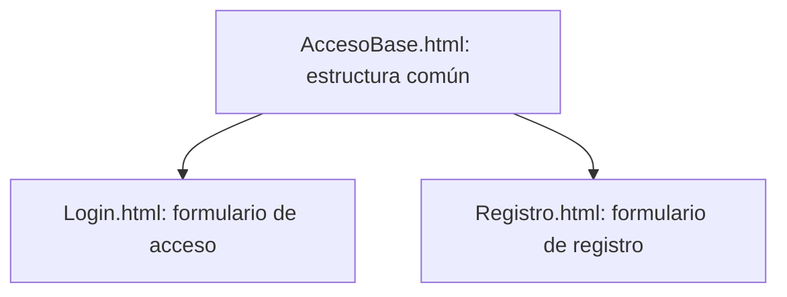
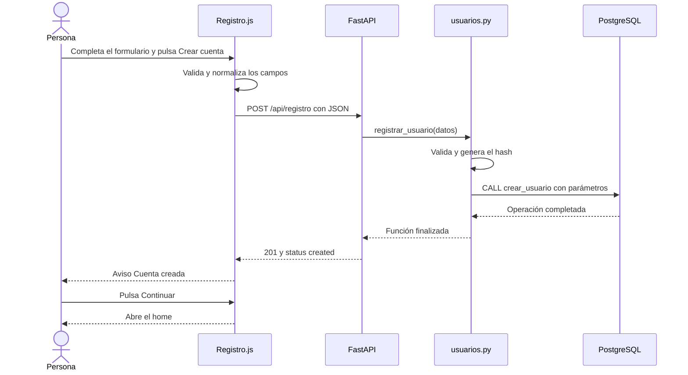

# Gestión de iglesia — TCU

Resumen técnico y bitácora del avance del **8 de octubre de 2026**. Documento elaborado el **10 de octubre de 2026**, como continuación de `7_de_Octubre.md`.

Se amplió la aplicación de la iglesia Efrata con las pantallas de acceso y creación de cuentas. Se conectó el formulario de registro con FastAPI y se preparó el almacenamiento de usuarios en PostgreSQL mediante un procedimiento. El inicio de sesión quedó como siguiente etapa.

## 1. Adaptación de la interfaz

Se conservó el diseño del home con tonos azul oscuro y dorado. Se adaptó el menú para que pueda desplegarse en pantallas pequeñas y se mantuvo la navegación lateral en escritorio.

Se crearon las pantallas de inicio de sesión y registro con la identidad de **Efrata**, campos amplios y distribución en una columna para facilitar su uso desde celulares. Se mantuvieron HTML y CSS propios, sin incorporar Bootstrap.

## 2. Organización de los archivos

Se separó la presentación, la interacción del navegador y la función que registra usuarios. Los principales archivos de esta etapa son:

```text
tcu-app/
├── backend/app/
│   ├── app.py                 # Rutas HTML y API de registro
│   ├── database.py            # Conexión reutilizable a PostgreSQL
│   └── usuarios.py            # Validación, hash y llamada al procedimiento
└── frontend/
    ├── templates/
    │   ├── AccesoBase.html    # Estructura compartida de acceso
    │   ├── Login.html         # Formulario visual de inicio de sesión
    │   └── Registro.html      # Formulario de creación de cuenta
    └── static/
        ├── css/acceso.css     # Diseño responsivo y avisos
        ├── js/Acceso.js       # Mostrar contraseña y comportamiento compartido
        └── js/Registro.js     # Validaciones, AJAX y confirmación de registro
```

Se conservaron `Index.html`, `Home.js`, `styles.css` y la consulta de prueba de la etapa anterior.

## 3. Plantillas compartidas con Jinja2

Se utilizó `AccesoBase.html` para compartir el logo, la estructura, los estilos y los scripts del acceso. Login y Registro declaran esa base mediante:

```jinja2

```

Se definieron los bloques `title`, `back_link` y `content`. Cada página puede reemplazar esos espacios; el login deja vacío `back_link` para ocultar el enlace de volver.



FastAPI selecciona la plantilla de la página y Jinja la combina con la base. Los bloques no son variables globales ni dependen de la página visitada anteriormente. El navegador recibe el HTML resultante.

## 4. Datos del formulario de registro

Se definieron los siguientes campos:

| Campo | Tratamiento |
| --- | --- |
| Cédula | Nueve dígitos; se comprueba el formato |
| Nombre(s) | Obligatorio, hasta 100 caracteres |
| Primer apellido | Obligatorio, hasta 100 caracteres |
| Segundo apellido | Opcional, hasta 100 caracteres |
| Correo | Se eliminan espacios externos y se convierte a minúsculas |
| Contraseña | Entre 12 y 128 caracteres |
| Confirmación | Se compara con la contraseña en el navegador |

Se normalizaron los espacios de los nombres conservando su escritura y tildes. La contraseña no se recorta ni se convierte a minúsculas. La confirmación se utiliza en la interfaz y no se envía como campo del registro.

Se dejó fuera la consulta al Registro Civil. La comprobación de nueve dígitos no confirma que la cédula exista ni que pertenezca a quien completa el formulario. Las relaciones familiares también quedaron pendientes de definición.

## 5. Tabla de usuarios y procedimiento SQL

Se definió la tabla `usuarios` con los campos `id`, `cedula`, `nombres`, `primer_apellido`, `segundo_apellido`, `correo`, `password_hash` y `creado_en`.

Se estableció una cédula única y un índice único para el correo:

```sql
CREATE UNIQUE INDEX usuarios_correo_unico
    ON usuarios (lower(btrim(correo)));
```

El índice impide duplicar correos aunque cambien las mayúsculas o los espacios externos. También protege las actualizaciones y las solicitudes simultáneas.

Se entregó el procedimiento `public.crear_usuario` para ejecutarlo desde pgAdmin. Se confirmó su creación mediante la respuesta `CREATE PROCEDURE`. Recibe los datos y el hash, normaliza los valores, valida los campos e inserta el usuario. El segundo apellido vacío se guarda como `NULL`.

El SQL se ejecutó manualmente; no se incorporó un sistema automático de migraciones. Quedó pendiente conservar los scripts completos de usuarios y procedimientos como archivos versionados para reproducir esta parte del entorno.

## 6. Registro desde Python

Se creó `registrar_usuario(datos)` en `backend/app/usuarios.py`. La función recibe un diccionario, selecciona los campos esperados, valida sus tipos y longitudes y normaliza los datos antes de guardarlos.

Se utilizó `hashlib.scrypt` para generar el hash de la contraseña con una sal aleatoria producida por `secrets`. Se guardan el algoritmo, sus parámetros, la sal y el resultado; no se guarda la contraseña original.

Se reutilizó `get_connection()` y se realizó la llamada mediante parámetros de Psycopg:

```sql
CALL public.crear_usuario(%s, %s, %s, %s, %s, %s);
```

Los valores se entregan separados del texto SQL. El bloque `with` confirma la operación si termina correctamente y la revierte si se produce una excepción.

## 7. Rutas y comunicación AJAX

Se separó la entrega de las páginas de la recepción de datos:

| Método y ruta | Función |
| --- | --- |
| `GET /` | Mostrar el home |
| `GET /login` | Mostrar `Login.html` |
| `GET /registro` | Mostrar `Registro.html` |
| `POST /api/registro` | Recibir datos y ejecutar `registrar_usuario()` |

Se utilizó `def crear_cuenta(datos: dict)` para que FastAPI interprete el cuerpo JSON como un diccionario. La ruta es síncrona, igual que la conexión actual de Psycopg.

Se prepararon respuestas `201` para creación, `409` para duplicados, `422` para datos inválidos y `503` para fallos de base de datos.



Se utilizó `fetch()` para realizar AJAX: enviar los datos sin recargar la página. Se agregaron mensajes junto a los campos, un aviso general, un tiempo límite de espera y bloqueo del botón durante la solicitud para evitar dobles clics.

## 8. Confirmación visual del registro

Se incorporó SweetAlert2 en la página de registro mediante CDN. El aviso **Cuenta creada** aparece únicamente después de recibir `201` y `status: created` del backend.

Se adaptó el aviso a los colores de Efrata y se agregó el botón **Continuar**, que abre `/`. Si la librería externa no carga, se utiliza una alerta nativa como alternativa.

La navegación al home es parte de la demostración. No crea una sesión ni protege las rutas mediante autenticación.

## 9. Verificaciones realizadas

Se comprobó la sintaxis de Python y JavaScript. Se realizaron pruebas con conexión simulada para verificar la normalización de datos, la generación del hash, los parámetros SQL y el rechazo de entradas inválidas. También se comprobaron respuestas AJAX simuladas.

Estas comprobaciones no insertaron usuarios ni ejecutaron el procedimiento contra PostgreSQL. El usuario realizó una prueba local y continuó con los ajustes de confirmación visual; no se documentó una verificación independiente de la fila creada en la base.

## 10. Estado actual y siguiente etapa

Se dejó implementado el recorrido del registro y su confirmación visual. El formulario de login todavía no verifica credenciales.

Se entregó el procedimiento `obtener_usuario_login`, que busca por correo y devuelve al backend el identificador, el nombre y el hash. Su ejecución en PostgreSQL quedó pendiente de confirmación.

La siguiente etapa será:

1. Confirmar la creación del procedimiento de consulta para login.
2. Crear la función Python que verifica la contraseña usando la sal y los parámetros guardados.
3. Conectar una ruta de login y su llamada AJAX, sin enviar el hash al navegador.
4. Mostrar **Bienvenido** y abrir el home cuando las credenciales sean correctas.

Quedaron pendientes las sesiones, los permisos y roles, la recuperación de contraseña y la definición de relaciones familiares. También se conservaron textos de maqueta por actualizar y mensajes de validación del backend que la interfaz presenta de forma genérica. No se realizó un despliegue en la nube.
